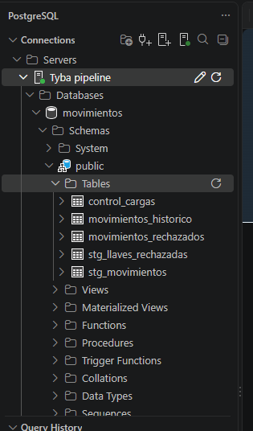
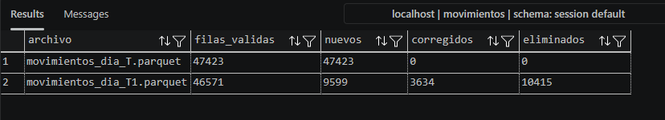

# Pipeline de movimientos financieros

Pipeline que ingiere los cortes diarios de movimientos (Parquet), los limpia y valida, y mantiene en PostgreSQL un histórico consultable de cada movimiento a lo largo del tiempo.

## Cómo correrlo

Requisito: Docker.

```bash
docker compose up --build
```

Esto levanta PostgreSQL, procesa en orden los cortes de `data/raw/` y genera en `data/output/`:

La carpeta `data/output/` incluye los resultados de una ejecución con los archivos de la prueba, como referencia. Se regeneran en cada corrida.

- `reporte.md`: métricas de calidad, evolución entre cortes y análisis de negocio.
- `rechazados.csv`: filas que no pasaron las validaciones, tal como llegaron y con su motivo, para revisión de negocio.

El pipeline es idempotente: volver a correrlo no reprocesa los cortes ya cargados. Para empezar desde cero, borrando también la base: `docker compose down -v`.

Para consultar la base: `docker compose exec postgres psql -U tyba -d movimientos`, o desde cualquier cliente en `localhost:5432` (usuario y contraseña `tyba`). Las credenciales están en el `docker-compose.yml` porque la prueba pide correr sin configuración adicional; en un entorno real irían en un gestor de secretos.

## Arquitectura

```
data/raw/*.parquet
   │
   ├─ Extracción      listar y ordenar cortes, validar esquema, lectura lazy (Polars)
   ├─ Transformación  normalizar → validar → identificar          (Polars)
   ├─ Carga           staging (COPY) → consolidación SCD2 → control (PostgreSQL)
   │
   └─ Insights        reporte.md + rechazados.csv
```

Python limpia y Postgres consolida. La limpieza en Polars es expresiva y fácil de probar; la comparación contra el histórico se hace en SQL porque es una operación sobre todo el conjunto de datos y la base la resuelve mejor.

Cada corte se procesa en una sola transacción: si cualquier paso falla, no queda nada a medias.



## Modelo de datos

| Tabla | Contenido |
|---|---|
| `movimientos_historico` | Todas las versiones de cada movimiento (SCD tipo 2): `corte_desde`, `corte_hasta`, `es_actual`, `eliminado` |
| `movimientos_actual` (vista) | Movimientos vigentes. Es la tabla para consultar |
| `movimientos_rechazados` | Log de filas rechazadas, con el dato original, motivo y archivo de origen |
| `control_cargas` | Una fila por corte procesado, con sus métricas |
| `stg_movimientos`, `stg_llaves_rechazadas` | Tablas de paso; se vacían en cada corte |

## Calidad de los datos


El análisis está en `notebooks/exploracion.ipynb`. Hallazgos y decisiones:

| Columna | Hallazgo | Decisión |
|---|---|---|
| `id` | No existe. Viene `id_cliente`: 3.000 clientes en 50.000 filas | Llave compuesta (ver abajo) |
| `type` | Mayúsculas mezcladas y valores en inglés (`IN`, `OUT`), ~8% | Normalizar a `entrada`/`salida`; cualquier otro valor se rechaza |
| `fund` | 7 fondos escritos de 23 formas: mayúsculas, espacios en los extremos y un doble espacio interno (`Mercado  Monetario`) | Colapsar espacios, minúsculas y formato título |
| `date` | Texto en dos formatos: ISO (~93%) y `DD/MM/YYYY` (~7%) | Interpretar ambos; si ninguno aplica, rechazar |
| `amount` | ~3% nulos | Rechazar: un movimiento sin monto no es utilizable |
| `amount` | ~2% negativos, todos en entradas | Rechazar: no se puede saber si el error está en el signo o en el tipo, y cada lectura afecta el saldo en sentido opuesto |
| `amount` | ~2% en cero | Se cargan |
| `description` | ~9% nulos | Se aceptan como nulos |
| `commercial_name` | ~17% nulos | Se aceptan como nulos |
| `description` × `type` | No hay coherencia: depósitos marcados como salida, retiros como entrada | No se rechaza; requiere definir con negocio qué combinaciones son válidas |

La limpieza de espacios se aplica a todas las columnas de texto, no solo donde apareció el problema. Las filas rechazadas no se descartan: quedan en `movimientos_rechazados` con todos sus motivos (una fila puede tener varios) para que negocio las revise.



## Identificación de movimientos

El enunciado indica que `id` identifica la transacción, pero el archivo trae `id_cliente`. Sin un identificador de transacción, uso una llave de negocio: `(id_cliente, date, product, fund, type)`.

La elegí con evidencia:
- Al comparar T y T1, las correcciones que encuentra cambian solo `amount`, `description` o `commercial_name`, nunca campos de la llave.
- Las filas que no se emparejan por llave tampoco se emparejan por cliente y monto (12 coincidencias en ~10.000), así que son altas y bajas reales y no correcciones de la llave.

Cerca del 0,2% de las filas comparte llave con otra dentro del mismo corte (movimientos distintos del mismo cliente, producto, fondo y tipo el mismo día). Se diferencian con una `secuencia` ordenada por monto, descripción y entidad, que se determina sin importar el orden del archivo. La limitación: si en un grupo así se corrige el monto y cambia el orden, el cambio se clasifica como dos correcciones en vez de una. El estado final no se ve afectado.

La recomendación es que el origen incluya un identificador de transacción.

## Consolidación entre cortes

Cada corte es una foto completa del estado, así que se compara contra las versiones vigentes del histórico:

| Caso | Acción |
|---|---|
| Nuevo | Se inserta una versión |
| Corregido | Se cierra la versión vigente y se inserta la nueva |
| Eliminado | Se cierra la versión vigente y se inserta una versión marcada como eliminada, con su último valor |
| Sin cambios | No se escribe nada |

Dos casos especiales:
- **Rechazados que no son eliminados.** Si un movimiento llega con un problema de calidad (por ejemplo, monto nulo), no está entre los válidos y parecería eliminado. El pipeline lo detecta por su llave y conserva su última versión válida. En T1 fueron 36 movimientos.
- **Reapariciones.** Si un movimiento eliminado vuelve a aparecer, se cierra su registro de eliminación y se inserta como nuevo.

Guardar el histórico es especialmente importante aquí: como la llave es inferida, el histórico permite auditar y reconstruir cualquier estado si se descubre un error de emparejamiento.

## Confiabilidad

- **Una transacción por corte.** Staging, rechazados, consolidación y registro de control se confirman juntos o no se confirma nada.
- **Idempotencia.** Los cortes ya registrados en `control_cargas` se saltan.
- **Orden.** Los cortes se ordenan por número (`T`, `T1`, ..., `T10`), no alfabéticamente. Si llega un corte anterior al último procesado, el pipeline falla en vez de reescribir la historia.
- **Validación de esquema.** Si faltan columnas o `amount` no es numérico, el corte no se procesa. Las columnas adicionales se ignoran.
- **Cuadre automático.** Al final de cada corte se verifica que nuevos + corregidos + sin cambios sea igual a los válidos recibidos, y que la tabla actual tenga exactamente los válidos más los protegidos. Si no cuadra, el corte se revierte.
- **Integridad en la base.** Un índice único parcial impide que un movimiento tenga dos versiones vigentes.

## Escalabilidad

- Lectura y transformación lazy con Polars, que optimiza el plan antes de ejecutarlo.
- Carga a Postgres con `COPY`, no con `INSERT` fila a fila.
- Consolidación en tres sentencias SQL sobre conjuntos, no fila a fila.
- Índice parcial solo sobre las versiones vigentes, para que su tamaño no crezca con el histórico.
- Staging como tabla `UNLOGGED`: se carga más rápido y su contenido se puede regenerar desde el Parquet.

Con los archivos de la prueba (~50.000 filas por corte), cada corte toma alrededor de un segundo. Para volúmenes mucho mayores cambiaría:
- Particionar `movimientos_historico` por corte o por fecha.
- Con decenas de millones de filas por corte, llevarlo a Spark con Delta Lake: la misma lógica se traduce a un `MERGE INTO` y Databricks Workflows para la orquestación.

## Insights

El análisis completo, con gráficas, está en `notebooks/insights.ipynb`. Lo principal:

1. **~5% de cada corte llega inutilizable**, siempre por `amount`, con proporciones estables entre cortes: es un problema sistemático del origen.
2. **Más de la mitad de los movimientos cambia entre dos cortes consecutivos**: en T1, 22% eliminados, 20% nuevos y 7,7% corregidos.
3. **Los cambios son retroactivos.** Nuevos y eliminados se reparten en todo el mes, no solo en el día nuevo, que aporta apenas el 3% de los nuevos. Ningún periodo pasado puede tratarse como cerrado.
4. **Los totales ocultan la rotación.** Se movieron cerca de $488.000 millones entre altas y bajas para un efecto neto de $508 millones en el saldo; las correcciones cambian en promedio ~73% del monto de cada movimiento. Monitorear solo totales no revelaría este comportamiento.
5. **Negocio:** todos los fondos y productos tienen flujo neto positivo; CDT y Divisas lideran por tener menos salidas. El volumen está poco concentrado (el 10% de clientes más activos mueve el 15,5%). El 16,7% del volumen no tiene entidad asignada, el doble que cualquier entidad.

El patrón de rotación alta, distribución pareja en fechas, tipos y montos, y efecto neto casi nulo no es consistente con movimientos financieros reales. Recomiendo validarlo con el equipo dueño del origen.

## Limitaciones y próximos pasos

- Incluir un identificador de transacción en el origen. Eliminaría la llave inferida y la limitación de las colisiones.
- Definir con negocio la matriz válida de descripción × tipo, e incorporarla primero como regla de advertencia y luego de rechazo (por ejemplo, con Great Expectations o expectations de Delta Live Tables).
- Corregir en el origen los montos nulos y negativos.
- Agregar tests automatizados de las reglas de transformación y ejecutarlos en CI.
- Agregar fecha de corte en el nombre o contenido del archivo; hoy el orden se infiere del sufijo `T`, `T1`, ...

## Estructura

```
├── data/
│   ├── raw/              cortes de entrada
│   └── output/           reporte y rechazados (generados)
├── notebooks/
│   ├── exploracion.ipynb análisis de calidad de los datos crudos
│   └── insights.ipynb    análisis de los datos consolidados
├── src/
│   ├── pipeline.py       orquestación
│   ├── config.py
│   ├── db.py
│   ├── insights.py
│   ├── etl/
│   │   ├── extraccion.py
│   │   ├── transformacion.py
│   │   └── carga.py
│   └── sql/
│       ├── ddl.sql
│       ├── consolidacion.sql
│       └── insights.sql
├── Dockerfile
├── docker-compose.yml
└── requirements.txt
```